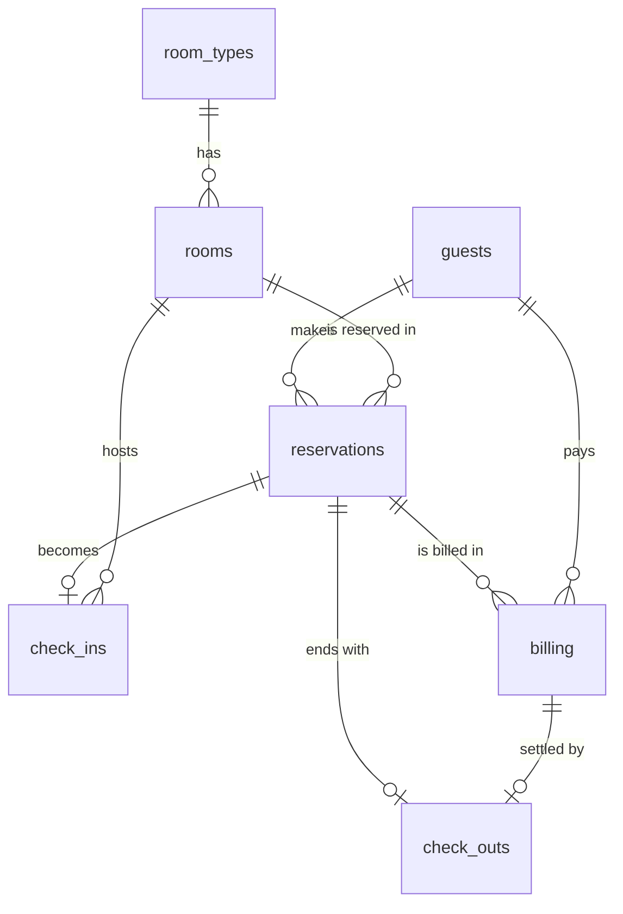

# Hotel Reservation System

Software Engineering - Construction Phase (one continuous project).

## Technologies
- HTML, CSS, JavaScript (no framework needed)
- Database: browser localStorage, designed with the tables from Stage 2
  (an equivalent SQL script is in `database/hotel_database.sql`)

## Folder Structure
```
hotel-reservation-system/
├── index.html            <- main page (layout)
├── README.md
├── css/
│   └── style.css         <- all styling
├── js/
│   ├── schema.js         <- database design: tables, keys, constraints (Stage 2)
│   ├── database.js       <- connection + insert/update/delete with validation
│   ├── database-page.js  <- "Database" page: data dictionary, sample data, tests
│   ├── helpers.js        <- small shared tools (peso format, dates, messages)
│   ├── room-types.js     <- Room Type Management (Lab 3)
│   ├── rooms.js          <- Room Management (Lab 4)
│   ├── availability.js   <- Room Availability Checking (Lab 5)
│   ├── guests.js         <- Guest Registration (Lab 6) and Guest Profile (Lab 7)
│   ├── reservations.js   <- Reservation Form, Validation, Confirmation, Search and History (Labs 8-11)
│   ├── checkin.js        <- Check-in Module and Walk-in Guest Check-in (Labs 12-13)
│   └── app.js            <- menu, pages, dashboard, logout
├── database/
│   └── hotel_database.sql  <- SQL version of the same design
└── images/
```

## How to Run
Open `index.html` in a web browser (or use the VS Code "Live Server" extension).
Open the **Database** menu to load sample data and run the constraint tests.
If you loaded sample data in Stage 2, click **Reset Database** and **Load Sample Data** once
more so every room gets the new `active_status` field.

## Stage 3 - Room Management
- **Room Types**: add, edit, view, activate/deactivate, search
- **Rooms**: add, edit, view, search/filter, change status, mark as maintenance, activate/deactivate
- **Availability**: `findAvailableRooms(checkIn, checkOut, guests, roomTypeId)` in `js/availability.js`
  (a confirmed overlapping reservation, maintenance, inactive rooms and too-small capacity make a room unavailable)

## Entity Relationship Diagram

(The `users` table is separate; it is used for login and roles.)

## Stage 4 - Guest Management
- **Guests** (Lab 6): register, edit, view, search/filter, activate/deactivate
  - Validation: required fields, unique guest number (format G-0001), valid email, valid mobile number
  - A guest with an upcoming Pending/Confirmed reservation cannot be deactivated
  - The identification reference is masked (`********`) everywhere except the edit form
- **Guest Profile** (Lab 7): guest details, reservation history, hotel transactions (check-ins, bills, check-outs) and total visits
  - Total Visits = reservations that are not cancelled

## Stage 5 - Reservation Management
- **Reservation form** (Lab 8): guest, dates, guests, room; shows the room charge (Rate x Nights); creates a Pending reservation with a unique number (R-0001, R-0002, ...)
- **Validation** (Lab 9): guest and room exist, room is active and not under maintenance, check-out after check-in, guests within room capacity, no overlap with Confirmed or Checked-in reservations, required fields
- **Confirmation** (Lab 10): Pending -> Confirmed (checked again before confirming); Cancel and No-show; statuses Checked-in and Checked-out are used in Stages 6 and 8
- **Search and history** (Lab 11): search by reservation number, guest, room; filter by status and date range
- Availability results now have a **Reserve** button that opens the form with the room and dates filled in

## Stage 6 - Check-in
- **Check-in** (Lab 12): search reservations, verify status, guest and room, record the actual check-in (date and time, guests), set the room to Occupied and the reservation to Checked-in
  - Only Confirmed reservations can be checked in, from the reserved check-in date until the day before check-out
  - Rooms that are occupied, being cleaned, under maintenance or inactive are refused
- **Walk-in guest** (Lab 13): register a new guest (or pick an existing one), choose dates and an available room, create a Confirmed reservation and check the guest in, all in one step. If anything fails, nothing is saved.
- The Checked-in Guests list and the dashboard Checked-in card show who is staying now
