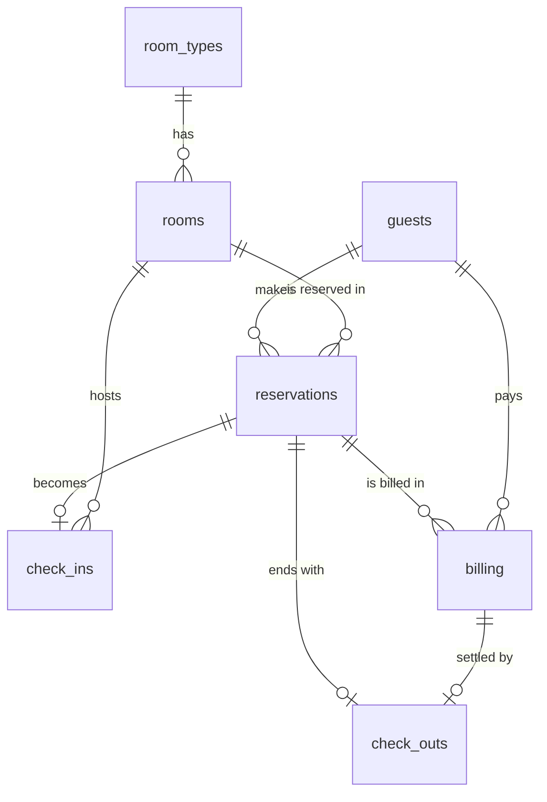

# Hotel Reservation System

Software Engineering - Construction Phase (one continuous project).

## Technologies
- HTML, CSS, JavaScript (no framework needed)
- Database: browser localStorage, designed with the tables from Stage 2
  (an equivalent SQL script is in `database/hotel_database.sql`)

## Folder Structure
```
hotel-reservation-system/
├── index.html            <- main page (layout)
├── README.md
├── css/
│   └── style.css         <- all styling
├── js/
│   ├── schema.js         <- database design: tables, keys, constraints (Stage 2)
│   ├── database.js       <- connection + insert/update/delete with validation
│   ├── database-page.js  <- "Database" page: data dictionary, sample data, tests
│   ├── helpers.js        <- small shared tools (peso format, dates, messages)
│   ├── room-types.js     <- Room Type Management (Lab 3)
│   ├── rooms.js          <- Room Management (Lab 4)
│   ├── availability.js   <- Room Availability Checking (Lab 5)
│   └── app.js            <- menu, pages, dashboard, logout
├── database/
│   └── hotel_database.sql  <- SQL version of the same design
└── images/
```

## How to Run
Open `index.html` in a web browser (or use the VS Code "Live Server" extension).
Open the **Database** menu to load sample data and run the constraint tests.
If you loaded sample data in Stage 2, click **Reset Database** and **Load Sample Data** once
more so every room gets the new `active_status` field.

## Stage 3 - Room Management
- **Room Types**: add, edit, view, activate/deactivate, search
- **Rooms**: add, edit, view, search/filter, change status, mark as maintenance, activate/deactivate
- **Availability**: `findAvailableRooms(checkIn, checkOut, guests, roomTypeId)` in `js/availability.js`
  (a confirmed overlapping reservation, maintenance, inactive rooms and too-small capacity make a room unavailable)

## Entity Relationship Diagram

(The `users` table is separate; it is used for login and roles.)
